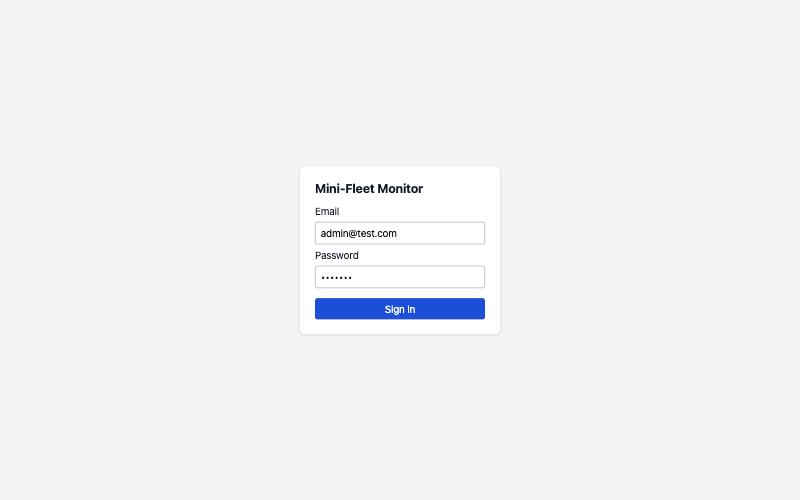
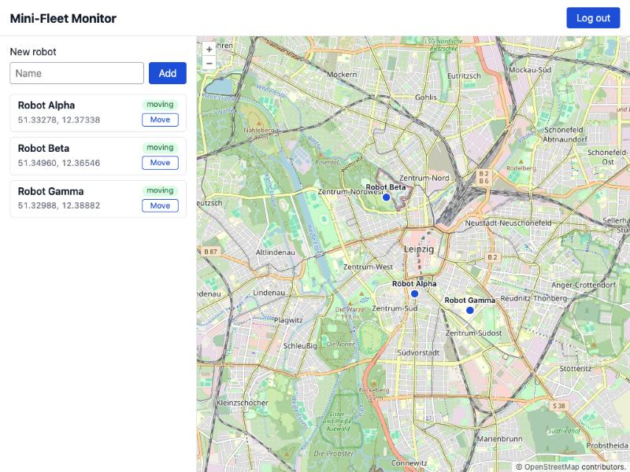

# Mini-Fleet Monitor

A small full-stack app that manages a list of virtual robots, shows them on an OpenLayers map and streams their positions live over WebSocket. Access is protected with a JWT login.

| Login                         | Dashboard                                               |
| ----------------------------- | ------------------------------------------------------- |
|  |  |

## Quick start (Docker)

```bash
docker compose up --build
```

Then open <http://localhost:8080> and sign in:

- Email: `admin@test.com`
- Password: `test123`

No `.env` file is needed: the compose file has demo defaults. On start the API container runs the migrations and the seed (one user, three robots), so the map is populated right away.

| Service     | Address                 |
| ----------- | ----------------------- |
| Web (nginx) | <http://localhost:8080> |
| API         | <http://localhost:3000> |
| PostgreSQL  | `localhost:5432`        |
| Redis       | `localhost:6379`        |

Ports can be changed with `WEB_PORT`, `API_PORT`, `POSTGRES_PORT` and `REDIS_PORT`.

## Local development

Requires Node.js 24.

```bash
cp .env.example .env          # then set JWT_SECRET (32+ characters)
docker compose up -d db redis

cd api
npm install
npm run migrate:up
npm run seed
npm run dev                   # http://localhost:3000

cd ../web
npm install
npm run dev                   # http://localhost:5173
```

## Tests

```bash
cd api
npm test
```

Integration tests run on Node's built-in test runner against a separate `robotsmoving_test` database, which `npm test` creates and migrates on its own. They need the `.env` from the setup above (overridden by the committed `.env.test`) and running PostgreSQL and Redis.

## Architecture

The API is a single Express process. A timer moves every robot by a small random step every 2 seconds; each move updates `robots` and appends to `robot_positions` in one transaction, then publishes the robot to a Redis Pub/Sub channel. Every API instance subscribes to that channel and relays the update to its WebSocket clients, which must send a valid JWT as their first message. `GET /robots` is cached in Redis for 10 seconds and serves as the initial snapshot; live positions arrive over WebSocket. The React frontend keeps the token in `localStorage`, loads the list once and then updates the list and the OpenLayers markers from the socket.

```
timer / POST /robots/:id/move
        │
        ▼
   PostgreSQL ──► Redis Pub/Sub ──► WebSocket ──► list + map
```

## API

All routes except `/health` and `/auth/login` need `Authorization: Bearer <token>`. Errors have the form `{"error": "..."}`.

| Method | Path               | Description                            |
| ------ | ------------------ | -------------------------------------- |
| GET    | `/health`          | Liveness check                         |
| POST   | `/auth/login`      | Email and password → `{ token }`       |
| GET    | `/auth/me`         | Current user                           |
| GET    | `/robots`          | All robots; `X-Cache: HIT\|MISS`       |
| POST   | `/robots`          | Create a robot: `{ name, lat?, lon? }` |
| POST   | `/robots/:id/move` | Move one robot by a random step        |

WebSocket: connect to `ws://localhost:3000/ws` and send `{"type":"auth","token":"<JWT>"}` within 5 seconds. Updates arrive as `{"type":"robot.updated","robot":{...}}`.

## Task checklist

- Node.js + Express, PostgreSQL, Redis cache, JWT auth, CORS, REST + WebSocket, Docker Compose
- React (JavaScript), OpenLayers map, login page, protected dashboard, live markers
- Optional: `POST /robots`, Redis cache for `GET /robots` (TTL 10 s)
- Bonus: Redis Pub/Sub, position history (`robot_positions`), Dockerfiles for API and web

## Known limitations

- No Start/Stop control: the simulation always runs, so a robot stays `moving` after its first step.
- No rate limiting or security headers.
- Running several API instances would also run several simulators; the simulator would have to move to its own process.
- The WebSocket client reconnects every 2 seconds without a retry limit, and there is no ping/pong liveness check.
- If Redis is down the API keeps working: the cache is skipped and updates go only to clients of the same instance.
- Tests cover the HTTP API only.
